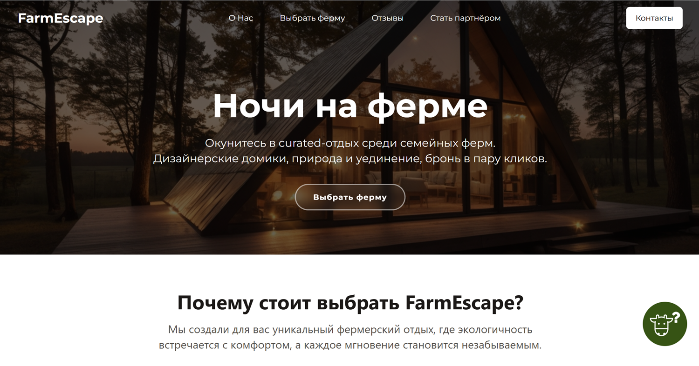
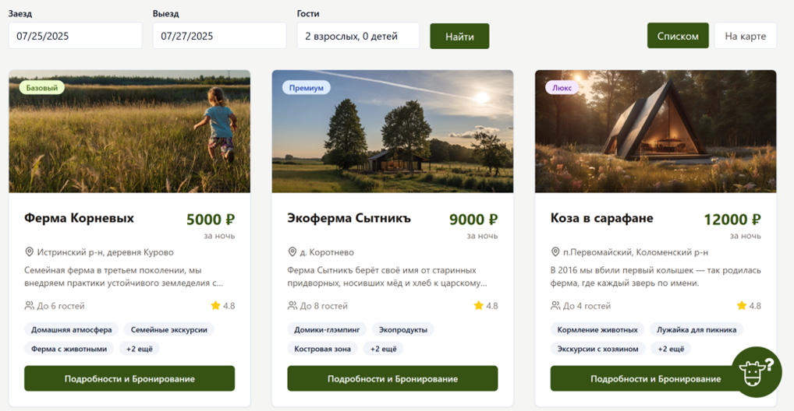
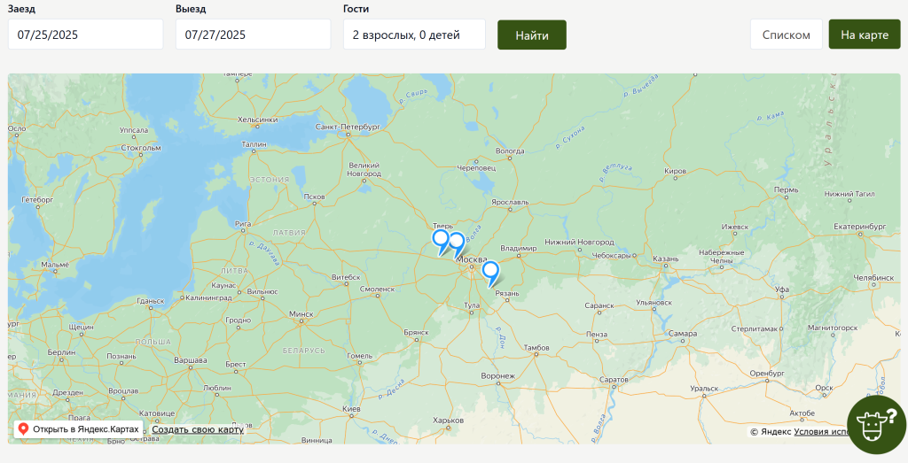
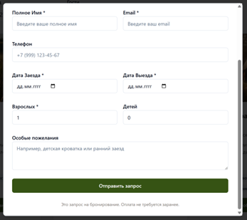
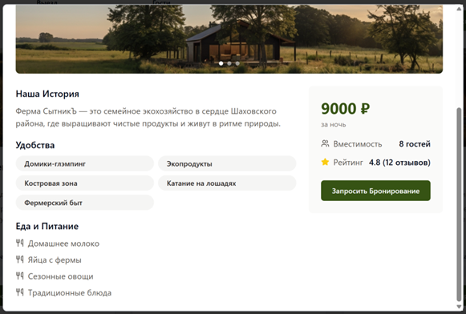

# FarmEscape Booking Website

A frontend prototype for exploring farm stays in the Moscow region.

This is my first React and TypeScript learning project. The initial
prototype was created with Lovable, then customized as part of my
frontend learning process.

## Screenshots








## Features

- Catalogue of three farms with photos, prices, and amenities
- Filtering by the number of guests
- Farm details with a photo gallery
- Booking form with a cost estimate
- List and map views

## Tech stack

- TypeScript
- React
- Vite
- CSS / UI components
- Lovable for the initial AI-assisted prototype

## Run locally

Node.js and npm are required.

```bash
npm ci --legacy-peer-deps
npm run dev
```

Open the address printed in the terminal, usually http://localhost:8080.

The frontend can be opened without starting the backend.
The legacy peer dependency option is needed because the chat widget
declares React 17 support while the project uses React 18.

## Current limitations

- Farm data and reviews are static demonstration content.
- Search filters by guest capacity; dates do not affect the results.
- The map needs a valid Yandex Maps API key.
- Chat shows a fixed demonstration response; AI consultation is unavailable.
- The booking form validates input and calculates cost without sending data.
- Farmer registration and authentication are unavailable.

## Project structure

- `src/pages` — application pages
- `src/components` — interface sections, cards, and forms
- `src/components/ui` — shared UI components
- `src/data` — demonstration farm data
- `src/types` — TypeScript types
- `public` — images and other public assets
- `server` — experimental backend

## My role and learning process

This project was created at the beginning of my frontend learning path.
The first version was generated with the help of Lovable, but I later reviewed, changed, and rebuilt many parts of the interface and project structure myself.

Through this project, I practiced:

- reading and navigating a large generated codebase;
- editing and adapting TypeScript/React components;
- improving UI structure after AI generation;
- working with a real multi-file frontend project;
- understanding the difference between a quick prototype and cleaner maintainable code.

